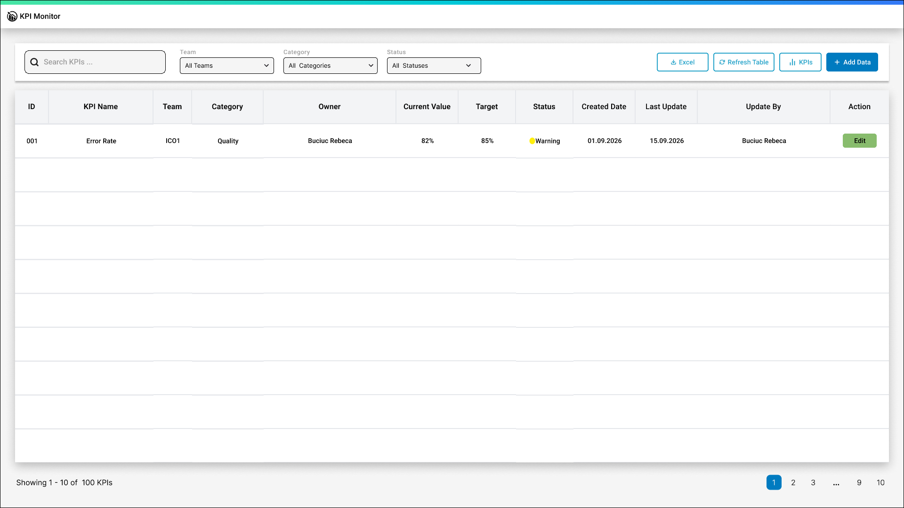
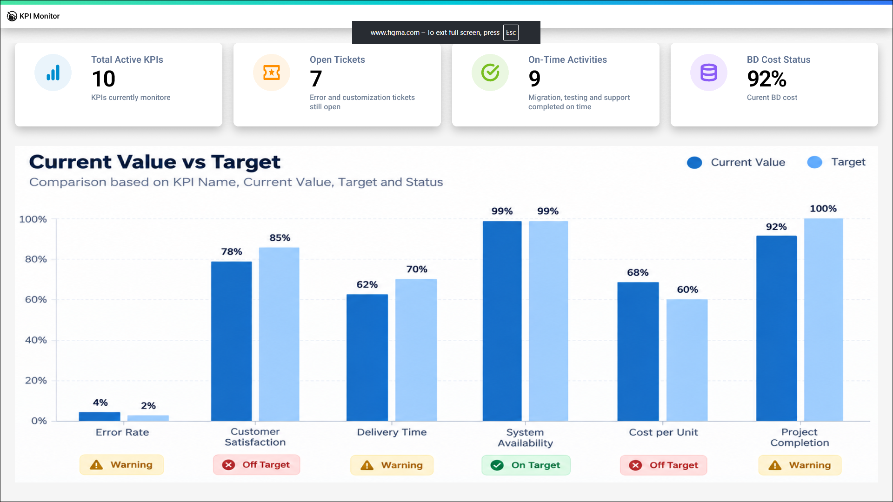

# KPI Monitor

A personal web application designed to help teams track key performance indicators, compare results with targets and monitor progress.

**Status: Work in progress.** The current focus is the Angular interface. A local Spring Boot backend and MySQL database have been set up, with REST API integration planned.

## Technologies

- **Frontend:** Angular 20, TypeScript, HTML, SCSS
- **Backend:** Java, Spring Boot
- **Database:** MySQL
- **UI Design:** Figma

## Current Progress

- Interface designs created in Figma.
- KPI management interface with a table and pagination layout.
- Search field and action buttons for adding KPIs and exporting data.
- Separate Angular components for the header, toolbar, table and pagination.
- Initial backend setup and local database connection.

The interface is currently a UI prototype. Functional search, pagination, KPI creation, editing and deletion, CSV export, dashboard charts and REST API integration are planned.

## UI Design (Figma)

Designs created in Figma for the planned application.

**KPI Management**



**Dashboard**



## Project Structure

| Folder | Content |
| --- | --- |
| `kpi-monitor-frontend/` | Angular application |
| `kpi-monitor-backend/` | Spring Boot backend |
| `images/` | Figma exports and project screenshots |

## Run the Frontend

Requires Node.js and npm.

From the project root, run:

```bash
cd kpi-monitor-frontend
npm install
npx ng serve
```

Open [http://localhost:4200](http://localhost:4200) in your browser.

The frontend can be viewed independently while backend integration is in progress.

The backend requires a local MySQL configuration. The local `application.properties` file and database credentials are excluded from this repository.
